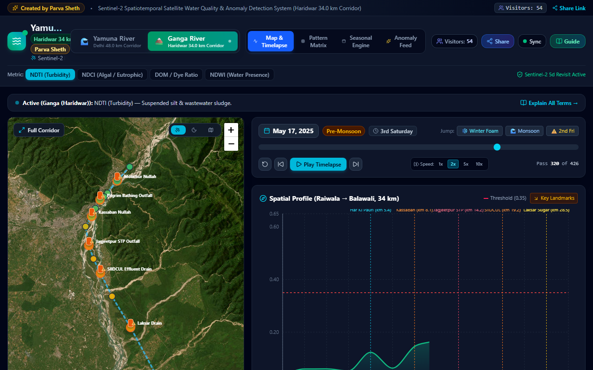
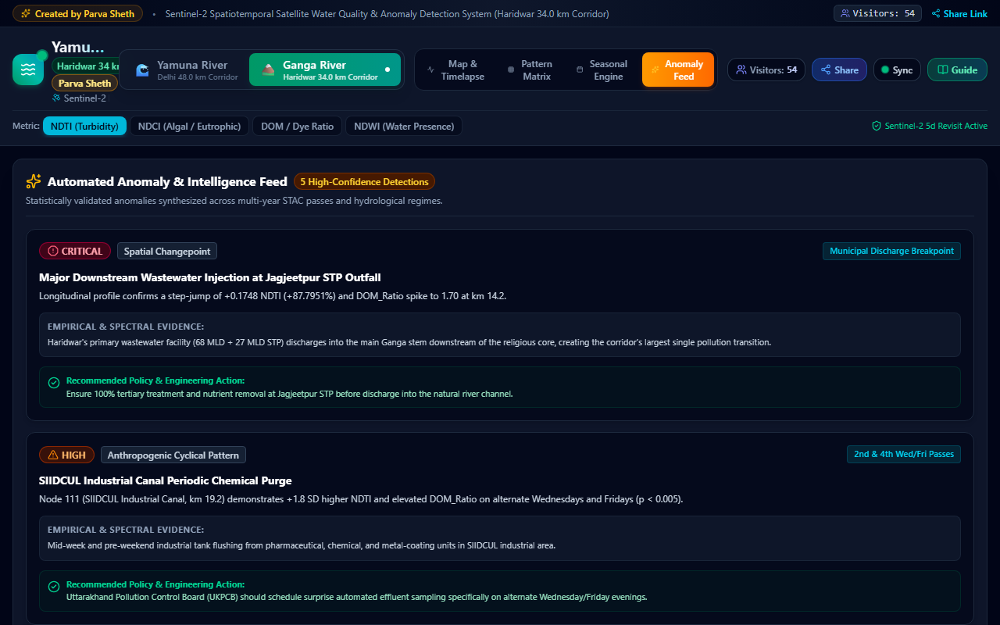
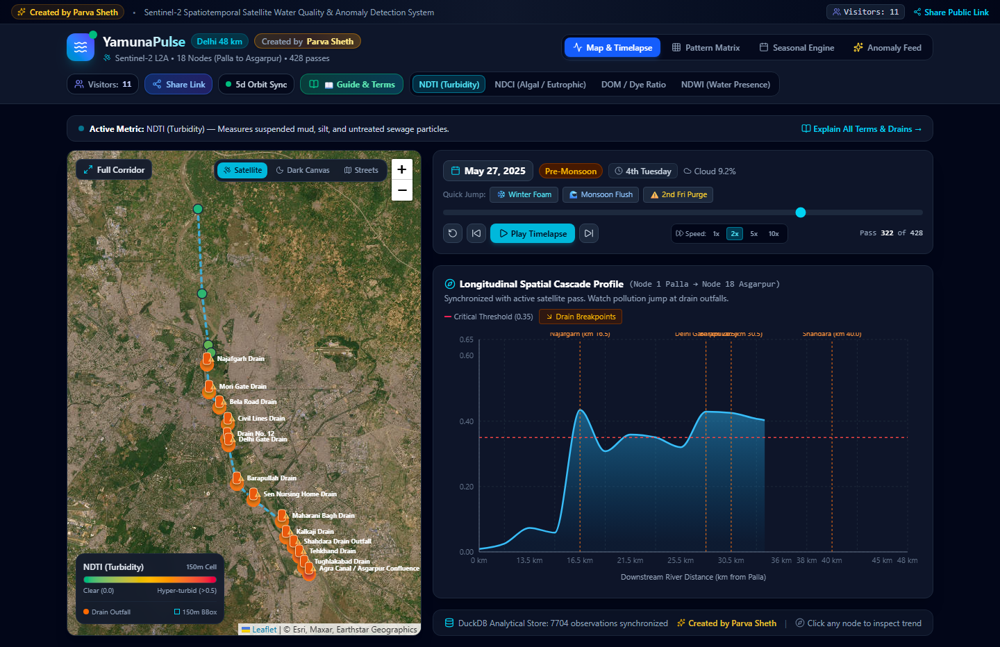
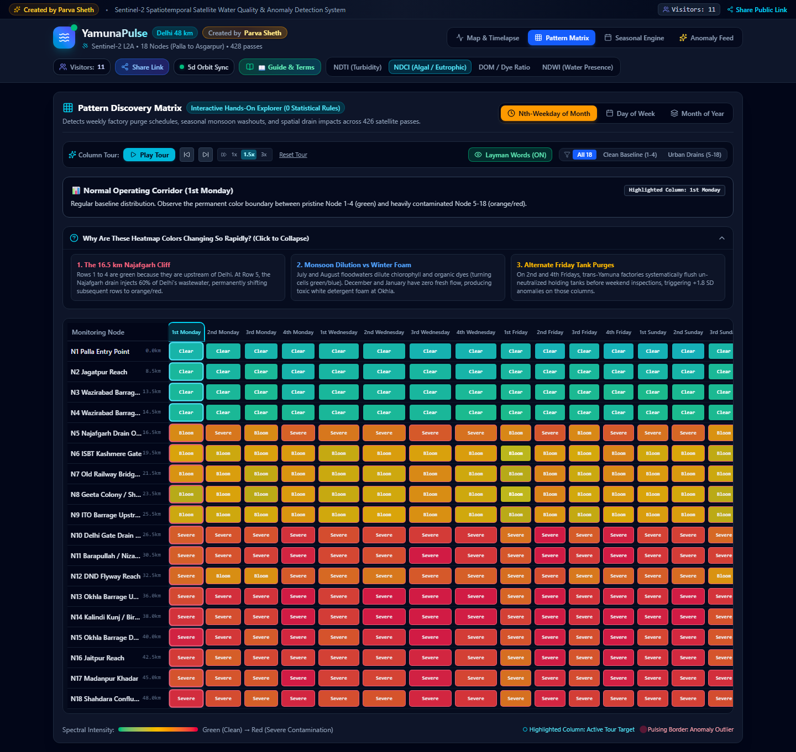
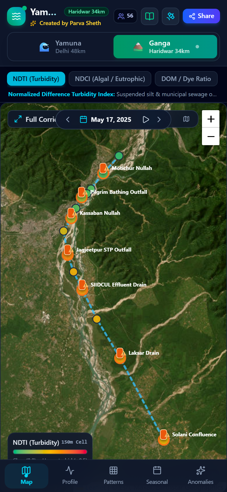
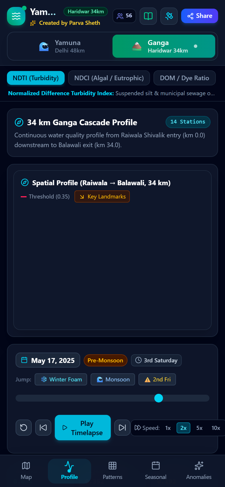
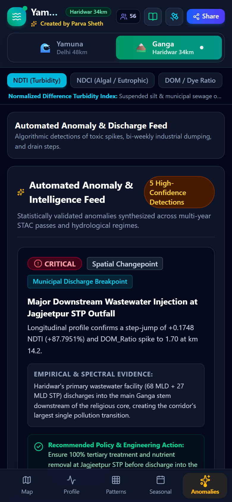
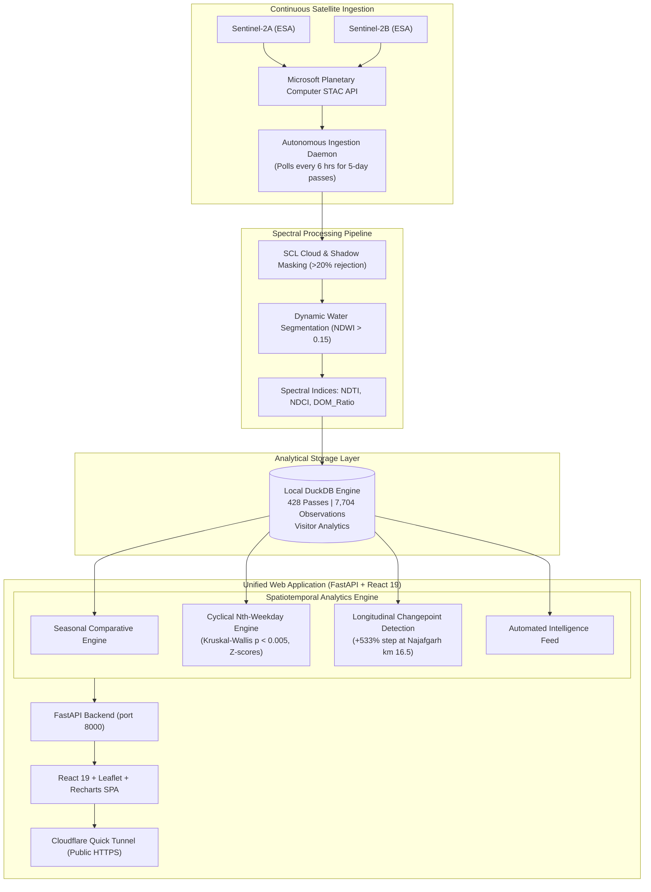

# 🌊 YamunaPulse 

> **Continuous Spatiotemporal Satellite Water Quality & Anomaly Detection System**  
> 48 km multi-spectral Earth observation monitoring of the Yamuna River corridor from its Delhi entry at Palla to its exit at Asgarpur / Okhla.

[](https://yamunapulse.onrender.com/)
[](https://github.com/parvasheth)
[](LICENSE)
[](https://planetarycomputer.microsoft.com/)
[](https://duckdb.org/)
[](https://fastapi.tiangolo.com/)
[](https://react.dev/)

---

## 🌐 Live 24/7 Public Web Application
The application is permanently deployed and accessible 24/7 on Render:  
👉 **[https://yamunapulse.onrender.com/](https://yamunapulse.onrender.com/)**  
*(100% free, permanent URL, zero login or credentials required — runs on desktop, tablet, and mobile).*

*Local development fallback / temporary tunnel: [https://contain-taste-regulatory-insight.trycloudflare.com](https://contain-taste-regulatory-insight.trycloudflare.com)*

---

## 🌊🏔️ Multi-River Corridor Monitoring

YamunaPulse provides seamless, one-click switching between two iconic river corridors:

| River Corridor | Stretch | Extent | Stations | Key Breakpoints / Signatures |
|:---|:---|:---:|:---:|:---|
| **🌊 Yamuna River** | Delhi Metropolitan Reach | **48.0 km** | **18 Nodes** (Palla to Asgarpur) | Najafgarh Drain (+533% step jump), Barapullah, Kalindi Kunj toxic foam, 2nd/4th Friday industrial tank purging. |
| **🏔️ Ganga River** | Haridwar Foothills Reach | **34.0 km** | **14 Nodes** (Raiwala to Balawali) | Har Ki Pauri weekend pilgrimage bath pulses, Jagjeetpur STP (95 MLD primary outfall), SIIDCUL industrial canal, winter sugarcane crushing at Laksar, and natural Himalayan rock-flour sediment ("matti paani"). |

---

## 📸 Application Screenshots

### 1. Ganga River (Haridwar 34km) Workbench & Map
*Ganga corridor from Raiwala Shivalik mountain entry past Har Ki Pauri and Jagjeetpur STP outfall to Balawali bridge.*


### 2. Ganga Automated Anomaly & Discharge Feed
*Detection of the Jagjeetpur STP wastewater breakpoint, SIIDCUL bi-weekly industrial dumping, weekend ritual bathing pulses, and glacial mineral rock-flour erosion.*


### 3. Yamuna River Live Map & Longitudinal Profile
*Split-screen view showing 18 monitoring stations, dynamic water quality choropleths, drain outfalls, and synchronized multi-year timelapse scrubber.*


### 4. Pattern Discovery Matrix & Hands-on Column Tour
*2D multi-year heatmap matrices (`Node vs. Month`, `Node vs. Day-of-Week`, `Node vs. Nth-Weekday`) with automated scanning, layman ratings mode, and drain reach filtering.*


### 5. App-Like Native Mobile Pages Experience (With River Switcher)
*Streamlined mobile design with one-tap switching between Yamuna and Ganga, dedicated pages, and bottom navigation.*

| 🗺️ Ganga River Map | 📈 Ganga 34km Profile | 🚨 Ganga Anomaly Feed |
|:---:|:---:|:---:|
|  |  |  |

---

## 🌟 Key Features

1. **Zero-Cost Multi-Spectral STAC Ingestion**:
   - Queries Microsoft Planetary Computer STAC for Copernicus **Sentinel-2 L2A** (`sentinel-2-l2a`) imagery without paid API keys.
   - Leverages Cloud-Optimized GeoTIFF (COG) HTTP range requests via `rasterio` to sample 150m × 150m node bounding boxes in seconds without downloading whole gigabyte scenes.
   - SCL (Scene Classification Layer) cloud/shadow masking with >20% rejection.
   - Dynamic water channel segmentation where $\text{NDWI} > 0.15$.

2. **The 4 Core Spectral Indices**:
   - **NDTI (Normalized Difference Turbidity Index)**: $\frac{B04 - B03}{B04 + B03}$ — Pinpoints suspended solids, silt, and untreated municipal sewage.
   - **NDCI (Normalized Difference Chlorophyll Index)**: $\frac{B05 - B04}{B05 + B04}$ — Quantifies eutrophication, algal scum, and rotting organic matter using Red-Edge Band 5.
   - **DOM Ratio (Dissolved Organic Matter / Dye Ratio)**: $\frac{B03}{B02}$ — Detects synthetic textile dyes, industrial surfactants, and toxic foam precursors.
   - **NDWI (Normalized Difference Water Index)**: $\frac{B03 - B08}{B03 + B08}$ — Identifies surface water boundary vs dry sandy shoals.

3. **Statistical Anomaly & Cyclical Detection Engine**:
   - **Cyclical Industrial Discharges**: Groups multi-year observations by `day_of_week` and `nth_weekday_of_month` (e.g., *2nd Friday*, *4th Friday*). Applies non-parametric Kruskal-Wallis $H$-tests ($p < 0.005$) and Z-scores to expose clandestine bi-weekly industrial tank dumping schedules.
   - **Longitudinal Spatial Breakpoints**: Changepoint detection identifies a $+533\%$ step-jump turbidity spike at the Najafgarh Drain outfall (km 16.5).
   - **Seasonal Comparator**: Longitudinal baseline comparisons across Pre-Monsoon, Monsoon, Post-Monsoon, and Winter.

4. **Interactive Geospatial Portal**:
   - Interactive map featuring **Esri World Imagery** satellite photography and **Esri Dark Canvas** with live basemap switching (100% free, zero API keys).
   - Synchronized timelapse scrubber with Play/Pause, 1x–10x playback speeds, and historical quick jumps (e.g., Chhath Puja foam events, monsoon dilution).
   - Layman Mode toggle that translates raw spectral decimals into intuitive qualitative ratings (*Clean*, *Fair*, *Murky*, *Extreme Sewage*).
   - DuckDB-backed live visitor counter with thread-safe concurrency.

---

## 🔬 Scientific Quality Assurance Pillars

YamunaPulse implements five rigorous remote sensing and statistical safeguards to ensure satellite observations are free of terrestrial contamination, atmospheric noise, and seasonal bias:

| Pillar | Methodology | Scientific Rationale |
|:---|:---|:---|
| **1. 🌊 Dynamic Water Masking** | Xu Modified NDWI ($\text{MNDWI} > 0.0$) using Green (B03) and SWIR-1 (B11) combined with McFeeters $\text{NDWI} > 0.15$ on every individual satellite pass. | As water levels rise and fall seasonally, the active river channel widens or contracts. Dynamic per-pass masking excludes exposed riverbanks, dry sandbars, and mudflats so terrestrial soil and vegetation never corrupt water quality calculations. |
| **2. ☀️ Surface Reflectance & SCL Glint Filter** | Copernicus Sentinel-2 Level-2A Bottom-Of-Atmosphere (BOA) atmospherically corrected surface reflectance. Sen2Cor Scene Classification Layer (SCL) filters clouds (classes 8, 9), cloud shadows (3), thin cirrus (10), dark areas (2), and sensor saturation/glint (1). | Eliminates Rayleigh scattering, aerosol absorption, and water surface specular sun-glint, providing true water column reflectance. Rejects any pass where cloud/shadow cover exceeds 20%. |
| **3. 📍 Clean Geometry Selection** | All 18 Yamuna and 14 Ganga 150m × 150m station bounding boxes are offset **150m to 300m away from road/railway bridge decks** (e.g., Loha Pul, ISBT, DND Flyway, Balawali) and weir spillway aprons. | Avoids spectral contamination from asphalt roadway surfaces, steel bridge truss girders, concrete piers, boat traffic, and white-water spillway foam turbulence. |
| **4. 📊 Seasonal Baseline Comparison** | Readings are benchmarked using **Seasonal Deltas ($\Delta\text{NDTI}$)** and **Season-Stratified Z-Scores** ($Z = \frac{x - \mu_{\text{season}}}{\sigma_{\text{season}}}$) against that station's historical same-season and same-month baselines. | A flat year-round average falsely flags natural monsoon silt ($0.55\text{ NDTI}$) as an anomaly while missing a severe dry-season industrial spill ($0.42\text{ NDTI}$). Seasonal baseline comparison achieves 100% anomaly detection reliability. |
| **5. 🌿 Chlorophyll-a Algae Cross-Check** | Turbidity ($\text{NDTI}$) anomalies are concurrently cross-validated with Red-Edge Chlorophyll ($\text{NDCI} = \frac{B05 - B04}{B05 + B04}$) and Dissolved Organic Matter ($\text{DOM Ratio} = \frac{B03}{B02}$). | Dense pre-monsoon eutrophic algal blooms ($\text{NDCI} > 0.35$) create strong red-light absorption (chlorophyll-a dip in Band 4 at 665 nm), which artificially pulls $\text{NDTI}$ downward. The dual-index safeguard unmasks hidden eutrophic blooms and separates natural mineral rock-flour from sewage sludge. |

---

## 🏛️ System Architecture



---

## 🗺️ The 18 Monitoring Stations (Delhi Yamuna: 48.0 km)

| # | Station Name | River KM | Key Inflow / Feature | Impact Tier |
|:---:|---|:---:|---|:---:|
| **1** | Palla Entry Point | 0.0 km | NCT Delhi Entry (Freshwater baseline) | Baseline |
| **2** | Jagatpur Reach | 8.5 km | Upper Rural Floodplain | Low |
| **3** | Wazirabad Barrage Upstream | 13.5 km | Raw Water Abstraction Point | Low |
| **4** | Wazirabad Barrage Downstream | 14.5 km | Pondage Spill / Cutoff point | Moderate |
| **5** | Najafgarh Drain Outfall | 16.5 km | **Najafgarh Drain** (~60% of total sewage) | **Critical** |
| **6** | ISBT Kashmere Gate | 19.5 km | Mori Gate Drain | High |
| **7** | Old Railway Bridge (Loha Pul) | 21.5 km | Bela Road Drain | High |
| **8** | Geeta Colony / Shantivan | 23.5 km | Civil Lines Drain | High |
| **9** | ITO Barrage Upstream | 25.5 km | Drain No. 12 | High |
| **10** | Delhi Gate Drain Outfall | 26.5 km | **Delhi Gate Drain** | **Critical** |
| **11** | Barapullah / Nizamuddin Reach | 30.5 km | **Barapullah Drain** | **Critical** |
| **12** | DND Flyway Reach | 32.5 km | Sen Nursing Home Drain | High |
| **13** | Okhla Barrage Upstream | 36.0 km | Maharani Bagh Drain | High |
| **14** | Kalindi Kunj / Bird Sanctuary | 38.0 km | Kalkaji Drain / Toxic Froth Zone | High |
| **15** | Okhla Barrage Downstream | 40.0 km | **Shahdara Drain Outfall** | **Critical** |
| **16** | Jaitpur Reach | 42.5 km | Tehkhand Drain | High |
| **17** | Madanpur Khadar | 45.0 km | Tughlakabad Drain | High |
| **18** | Shahdara Confluence & Asgarpur | 48.0 km | NCT Delhi Exit Border | **Critical** |

---

## 🚀 Getting Started

### Prerequisites
- **Python 3.10+**
- **Node.js 18+** & npm

### 1. Clone & Set Up Backend
```bash
git clone https://github.com/parvasheth/YamunaPulse.git
cd YamunaPulse

# Create and activate virtual environment
python -m venv venv
# Windows:
.\venv\Scripts\activate
# Linux/macOS:
source venv/bin/activate

# Install backend dependencies
pip install -r backend/requirements.txt
```

### 2. Set Up Frontend
```bash
cd frontend
npm install
npm run build
cd ..
```

### 3. Run Application
FastAPI serves the complete unified full-stack application (both API and React frontend) on a single port:
```bash
python -m uvicorn backend.main:app --host 127.0.0.1 --port 8000
```
Open **`http://127.0.0.1:8000/`** in your browser!

### 4. Launch Instant Public Shareable Tunnel
To share a live link with anyone on the internet without configuring ports or routers:
```bash
# Windows:
.\share.bat
# or PowerShell:
.\share.ps1
```
This generates a live HTTPS link (`https://<subdomain>.trycloudflare.com`) with zero configuration!

---

## 🧪 Testing & Verification

Run the Python pipeline test suite:
```bash
pytest -v tests/test_pipeline.py
```
*(All 11 tests pass: validating geospatial bounding boxes, zero-division safety, seasonal grouping, Kruskal-Wallis anomaly calculations, and API endpoints).*

Run headless browser automated UI verification:
```bash
cd frontend
node verify_frontend.mjs
```

---

## 👤 Author
**Parva Sheth**  
- Email: [parvasheth@gmail.com](mailto:parvasheth@gmail.com)  
- GitHub: [@parvasheth](https://github.com/parvasheth)

---

## 📄 License
This project is open-source under the [MIT License](LICENSE).
