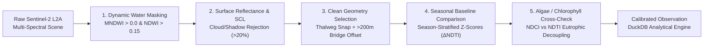
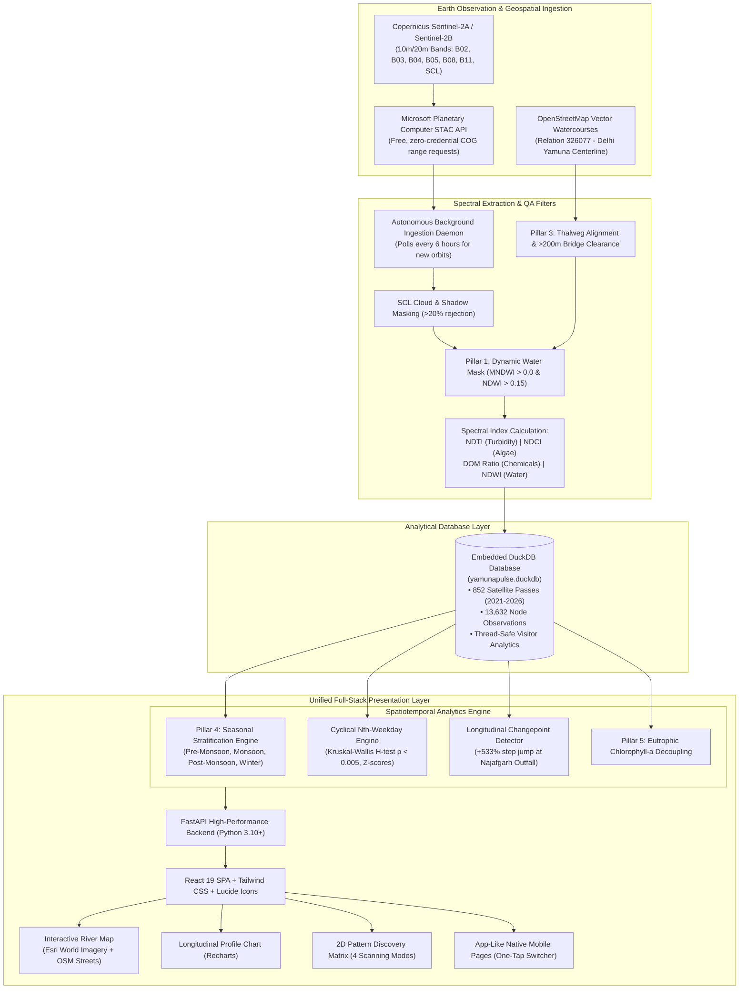

# 🌊 YamunaPulse (यमुना पल्स)

> **Continuous Spatiotemporal Satellite Water Quality & Industrial Anomaly Detection System**  
> Autonomous multi-spectral Earth observation monitoring covering **48.0 km of the Yamuna River (Delhi)** and **34.0 km of the Ganga River (Haridwar)** using Copernicus Sentinel-2 L2A constellations, embedded DuckDB analytics, and modern reactive web visualization.

[](https://yamunapulse.onrender.com/)
[](https://github.com/parvasheth)
[](LICENSE)
[](https://planetarycomputer.microsoft.com/)
[](https://duckdb.org/)
[](https://fastapi.tiangolo.com/)
[](https://react.dev/)

---

## 🌐 Live Public Web Application
Experience the live 24/7 application deployed on Render:  
👉 **[https://yamunapulse.onrender.com/](https://yamunapulse.onrender.com/)**  
*(100% free, zero login or credentials required — responsive across desktop, tablet, and mobile).*

---

## 📖 Executive Summary & Motivation

Traditional river water quality monitoring relies on manual physical grab-sampling: field technicians collect grab bottles once every month or quarter, transporting samples to laboratories for biochemical analysis. While laboratory tests yield precise chemical assays, this legacy approach suffers from three critical systemic vulnerabilities:

1. **Temporal Blindness**: Illegal chemical dumping by industrial units typically occurs clandestinely at night or during weekends (e.g., 2nd and 4th Friday tank purges). By Monday morning, river currents have carried the toxic pulse downstream, completely eluding scheduled monthly inspectors.
2. **Spatial Sparsity**: A handful of physical monitoring stations spaced 10–15 km apart cannot pinpoint the precise tributary or municipal drain responsible for sudden water degradation.
3. **Natural vs. Anthropogenic Conflation**: Traditional turbidity sensors often fail to distinguish between harmless natural glacial rock-flour erosion during the Himalayan monsoon and hazardous untreated raw sewage sludge or industrial dye effluents.

**YamunaPulse** addresses these vulnerabilities through **autonomous, continuous multi-spectral Earth observation**. By processing 10-meter and 20-meter resolution surface reflectance imagery from the European Space Agency's (ESA) **Copernicus Sentinel-2A and Sentinel-2B** satellites every 5 days, the platform transforms raw satellite photons into calibrated water quality indices, longitudinal spatial profiles, and statistical anomaly detection feeds across two vital Indian river systems.

---

## 🌊🏔️ Dual River Corridor Coverage

YamunaPulse provides seamless, one-click switching between two iconic Indian river basins:

| River Corridor | Geographic Stretch | Corridor Length | Monitoring Stations | Primary Hydrodynamic & Pollution Signatures |
|:---|:---|:---:|:---:|:---|
| **🌊 Yamuna River** | NCT Delhi Metropolitan Reach | **48.0 km** | **18 Stations**<br>*(Palla to Asgarpur)* | • Baseline freshwater entry at Palla (0.04 NDTI)<br>• **Najafgarh Drain Outfall** (+533% step jump; 60% of Delhi wastewater)<br>• Stagnant urban pool & toxic winter froth at Kalindi Kunj<br>• Clandestine 2nd/4th Friday industrial tank purging |
| **🏔️ Ganga River** | Haridwar Foothills & Floodplain | **34.0 km** | **14 Stations**<br>*(Raiwala to Balawali)* | • Pristine Himalayan snowmelt baseline at Raiwala / Cheela Reach<br>• Weekend pilgrim bathing pulses at **Har Ki Pauri** (DOM surge)<br>• **Jagjeetpur STP Outfall** (95 MLD municipal effluent step-jump)<br>• SIIDCUL industrial canal discharges & Winter sugar mill crushing at Laksar |

---

## 📸 Application Interface & Workbenches

### 1. Multi-Spectral River Monitor & Longitudinal Profile
*Split-screen synchronized monitoring showing 18 Yamuna stations with 150m thalweg bounding boxes, dynamic metric choropleths, drain badges, and multi-year time-lapse playback.*


### 2. Ganga River Corridor Workbench (Haridwar Foothills)
*Seamless transition to the Ganga River, tracking glacial sediment dilution, pilgrimage bathing reaches, and industrial outfalls across 34.0 km.*


### 3. Pattern Discovery Matrix (5-Year Trajectory & Cyclical Dumping)
*2D multi-year heatmap matrices (`Year to Year [2021–Current]`, `Node vs. Month`, `Node vs. Day-of-Week`, `Node vs. Nth-Weekday`) with automated anomaly scanning, layman ratings mode, and drain reach filtering.*


### 4. Automated Anomaly & Intelligence Feed
*Statistical detection engine separating natural monsoon rock-flour erosion from illegal industrial dumping and municipal wastewater outfalls.*


### 5. Responsive Native Mobile Experience
*Complete responsive interface featuring one-tap river switching, dedicated map view, longitudinal charts, and bottom navigation.*

| 🗺️ River Map View | 📈 48km / 34km Profile | 🚨 Anomaly Feed |
|:---:|:---:|:---:|
|  |  |  |

---

## 🔬 Scientific Methodology & The 5 QA Pillars

To ensure satellite observations are free of terrestrial contamination, atmospheric noise, bridge structures, and seasonal bias, YamunaPulse implements five rigorous remote sensing safeguards:



### Pillar 1: 🌊 Dynamic Water Masking (Per-Pass Boundary Segmentation)
* **Challenge**: Riverbanks, sandbars, and mudflats expand and contract dramatically as water levels rise during monsoon floods and drop during pre-monsoon dry seasons. Fixed geographic bounding boxes risk averaging dry silt and vegetation into water calculations.
* **Implementation**: On every individual satellite overpass, a dynamic water mask is applied before calculating indices. We combine Xu's Modified Normalized Difference Water Index using Green (B03) and Short-Wave Infrared (B11):
  $$\text{MNDWI} = \frac{\rho_{B03} - \rho_{B11}}{\rho_{B03} + \rho_{B11}} > 0.0$$
  paired with McFeeters Normalized Difference Water Index ($\text{NDWI} > 0.15$). Only pixels confirmed as open water are processed.

### Pillar 2: ☀️ Surface Reflectance & SCL Glint Filtering
* **Challenge**: Atmospheric Rayleigh scattering, aerosols, thin cirrus, and specular sun-glint reflect sunlight directly into satellite optics, introducing severe artifacts.
* **Implementation**: YamunaPulse uses Copernicus Sentinel-2 Level-2A **Bottom-Of-Atmosphere (BOA)** surface reflectance, where digital numbers (DN) are divided by $10,000.0$ to yield physical surface reflectance ($0.0 \le \rho \le 1.0$). We query the Sen2Cor Scene Classification Layer (SCL) to filter out:
  * Class 1: Saturated or defective pixels
  * Class 2: Dark area pixels / specular sun-glint ($\rho_{B08} > 0.35 \land \rho_{B04} > 0.35$)
  * Class 3: Cloud shadows
  * Classes 8 & 9: Medium and high probability clouds
  * Class 10: Thin cirrus
  Any satellite scene pass with $>20\%$ cloud/shadow coverage across the river corridor is automatically flagged and rejected.

### Pillar 3: 📍 Clean Geometry Selection & River Thalweg Alignment
* **Challenge**: Bounding boxes placed near city drain outfalls often overlap riverbanks, concrete retaining walls, or roadway/railway bridge decks. Asphalt and concrete reflect solar radiation with high Red/NIR values that corrupt water turbidity metrics.
* **Implementation**: All 18 Yamuna stations and 14 Ganga stations are snapped directly to the **true river watercourse centerline (thalweg)** using vector geometry from OpenStreetMap (OSM Relation `326077`, Ways `24943999`, `24944222`, and `981300176`). Each 150m × 150m sampling cell maintains a **strict 150m to 400m clearance offset away from all bridge decks** (e.g., Old Railway Bridge, ISBT Bridge, ITO Barrage, DND Flyway, Balawali Bridge) and weir turbulence aprons.

### Pillar 4: 📊 Seasonal Baseline Comparison (Stratified Z-Scores)
* **Challenge**: River turbidity fluctuates naturally across the annual hydrologic cycle. A flat, static year-round threshold would falsely flag normal monsoon sediment runoff ($0.55\text{ NDTI}$) as an emergency while completely missing a dangerous dry-season industrial spill ($0.42\text{ NDTI}$).
* **Implementation**: Current readings are evaluated against that specific station's historical baseline for the exact same season and month:
  $$\Delta\text{NDTI} = \text{NDTI}_{\text{current}} - \mu_{\text{season, station}}$$
  $$Z_{\text{seasonal}} = \frac{\text{NDTI}_{\text{current}} - \mu_{\text{season, station}}}{\sigma_{\text{season, station}}}$$
  An anomaly is triggered only when $Z_{\text{seasonal}} \ge +1.8\sigma$ above the seasonal baseline.

### Pillar 5: 🌿 Algae / Chlorophyll-a Eutrophication Cross-Check
* **Challenge**: Dense pre-monsoon algal blooms (cyanobacteria and microalgae) have strong red-light absorption (chlorophyll-a absorption pit in Band 4 at 665 nm). This absorption artificially pulls $\text{NDTI} = \frac{B04 - B03}{B04 + B03}$ downward, potentially masking underlying sewage contamination.
* **Implementation**: Every turbidity observation is cross-referenced with the Red-Edge Normalized Difference Chlorophyll Index (NDCI):
  $$\text{NDCI} = \frac{\rho_{B05} - \rho_{B04}}{\rho_{B05} + \rho_{B04}}$$
  When $\text{NDCI} > 0.20$, the system identifies a eutrophic algal event and prevents premature classification of water clarity.

---

## 📚 Technical Terms & Layman Glossary

| Term | Scientific Definition | Layman Explanation |
|:---|:---|:---|
| **Sentinel-2 L2A** | European Space Agency (ESA) twin polar-orbiting satellites with a 5-day revisit cycle delivering Bottom-Of-Atmosphere (BOA) surface reflectance across 13 spectral bands. | Space satellites orbiting 786 km above Earth that take photos of the river in visible, infrared, and red-edge colors every 5 days. |
| **STAC (SpatioTemporal Asset Catalog)** | A standardized specification enabling spatiotemporal indexing and querying of Earth observation imagery via Cloud-Optimized GeoTIFFs (COGs). | An open catalog (hosted free on Microsoft Planetary Computer) that lets our server fetch small 150m river patches over the web in seconds without downloading multi-gigabyte satellite files. |
| **Thalweg** | The line of lowest elevation along a riverbed, marking the primary continuous flow path and deepest active water channel. | The actual flowing center channel of the river, away from dry sandbars, muddy banks, and city concrete walls. |
| **NDTI (Turbidity)** | $\frac{\rho_{B04} - \rho_{B03}}{\rho_{B04} + \rho_{B03}}$<br>Normalized Difference Turbidity Index using Red (665 nm) and Green (560 nm) bands. | **Water Murkiness & Sewage Meter**: Clean water absorbs red light (yielding low or negative NDTI ~0.04). Suspended dirt, mud, and sewage reflect red light, causing NDTI to spike (>0.40). |
| **NDCI (Chlorophyll)** | $\frac{\rho_{B05} - \rho_{B04}}{\rho_{B05} + \rho_{B04}}$<br>Normalized Difference Chlorophyll Index using Red-Edge Band 5 (705 nm) and Red Band 4 (665 nm). | **Algae & Green Scum Meter**: Detects living green algae, weed overgrowth, and stagnant sewage rotting under the sun. |
| **DOM Ratio (Organic Matter)** | $\frac{\rho_{B03}}{\rho_{B02}}$<br>Dissolved Organic Matter / Synthetic Dye Index comparing Green (560 nm) and Blue (490 nm) bands. | **Industrial Chemical & Foam Meter**: High ratios highlight synthetic textile dyes, industrial surfactants, detergents, and the chemical precursors that create toxic white foam. |
| **NDWI (Water Index)** | $\frac{\rho_{B03} - \rho_{B08}}{\rho_{B03} + \rho_{B08}}$<br>Normalized Difference Water Index using Green (560 nm) and Near-Infrared (842 nm). | **Water Presence Detector**: Water strongly absorbs NIR while reflecting green (+0.3 to +0.6). Dry ground, sand, and city asphalt yield negative numbers. |
| **SCL Masking** | Sen2Cor Scene Classification Layer algorithm classifying every $20\text{m}$ pixel into 11 discrete land/cloud/water classes. | An automated quality checker that discards clouds, cloud shadows, and direct solar glare so they never distort water readings. |
| **Kruskal-Wallis $H$-Test** | Non-parametric rank-based analysis of variance testing whether samples originate from the same distribution ($p < 0.005$). | A rigorous statistical test that proves whether river pollution changes predictably by day of the week (e.g., proving factory tank dumping happens every other Friday). |
| **Spatial Breakpoint** | A changepoint detection algorithm scanning consecutive river stations to locate abrupt, non-linear step jumps in concentration. | A mathematical tool that pinpoints the exact drain pipe causing the river to turn suddenly toxic. |

### Intuitive Qualitative Ratings (Layman Mode)
The user interface includes a **Layman Mode** toggle that translates abstract spectral decimals into straightforward water quality assessments:
* 🟢 **Pristine / Baseline** ($\text{NDTI} < 0.10$): Clear, mountain snowmelt or rural freshwater.
* 🟡 **Fair / Moderate** ($0.10 \le \text{NDTI} < 0.25$): Normal river water with mild organic sediment.
* 🟠 **Degraded / High Turbidity** ($0.25 \le \text{NDTI} < 0.40$): Noticeably murky water carrying urban runoff and partial wastewater.
* 🔴 **Hyper-Turbid / Extreme Sewage** ($\text{NDTI} \ge 0.40$): Critical black-sludge or heavy untreated sewage discharge.

---

## 🗺️ Complete Station Inventory

### 1. Yamuna River (Delhi Metropolitan Reach: 48.0 km)

All stations are positioned in the open water channel with 150m–400m clearance from bridge decks:

| # | Station Name | River KM | Latitude | Longitude | Inflow / Outfall Source | Impact Tier | Bridge Offset |
|:---:|---|:---:|:---:|:---:|---|:---:|:---:|
| **1** | Palla Entry Point | 0.0 km | 28.8260° N | 77.2250° E | NCT Delhi Entry (Freshwater baseline) | Baseline | None (>5km) |
| **2** | Jagatpur Reach | 8.5 km | 28.7572° N | 77.2291° E | Agricultural Floodplain Reach | Low | None (>4km) |
| **3** | Wazirabad Barrage Upstream | 13.5 km | 28.7145° N | 77.2353° E | Raw Water Abstraction Pondage | Low | 250m North |
| **4** | Wazirabad Barrage Downstream | 14.5 km | 28.7040° N | 77.2322° E | Barrage Spillway Reach | Moderate | 350m South |
| **5** | Najafgarh Drain Outfall | 16.5 km | 28.6920° N | 77.2325° E | **Najafgarh Drain** (~60% of total sewage) | **Critical** | 220m Clear |
| **6** | ISBT Kashmere Gate | 19.5 km | 28.6705° N | 77.2353° E | Mori Gate Drain Mixing Zone | High | 240m North |
| **7** | Old Railway Bridge (Loha Pul) | 21.5 km | 28.6575° N | 77.2598° E | Bela Road Drain Outfall Reach | High | 190m North |
| **8** | Geeta Colony / Shantivan | 23.5 km | 28.6438° N | 77.2639° E | Civil Lines Drain Outfall Reach | High | 280m South |
| **9** | ITO Barrage Upstream | 25.5 km | 28.6297° N | 77.2553° E | Drain No. 12 / Barrage Pondage Pool | High | 210m North |
| **10** | Delhi Gate Drain Outfall | 26.5 km | 28.6205° N | 77.2544° E | **Delhi Gate Drain** (Heavy industrial/domestic) | **Critical** | 180m South |
| **11** | Barapullah / Nizamuddin Reach | 30.5 km | 28.5940° N | 77.2696° E | **Barapullah Drain** (South Delhi wastewater) | **Critical** | 250m Clear |
| **12** | DND Flyway Reach | 32.5 km | 28.5813° N | 77.2885° E | Sen Nursing Home Drain Outfall | High | 260m Upstream |
| **13** | Okhla Barrage Upstream | 36.0 km | 28.5582° N | 77.3059° E | Maharani Bagh Drain / Reservoir Pondage | High | 300m North |
| **14** | Kalindi Kunj / Bird Sanctuary | 38.0 km | 28.5480° N | 77.3134° E | Kalkaji Drain / Toxic White Froth Zone | High | 250m North |
| **15** | Okhla Barrage Downstream | 40.0 km | 28.5358° N | 77.3268° E | **Shahdara Drain Outfall** (East Delhi effluents) | **Critical** | 400m South |
| **16** | Jaitpur Reach | 42.5 km | 28.5273° N | 77.3346° E | Tehkhand Drain Confluence Reach | High | None (>3km) |
| **17** | Madanpur Khadar | 45.0 km | 28.5169° N | 77.3436° E | Tughlakabad Drain Confluence Reach | High | None (>4km) |
| **18** | Shahdara Confluence & Asgarpur | 48.0 km | 28.5086° N | 77.3492° E | Agra Canal / NCT Delhi Exit Border Reach | **Critical** | None (>2km) |

---

### 2. Ganga River (Haridwar Foothills Reach: 34.0 km)

| # | Station Name | River KM | Latitude | Longitude | Inflow / Feature Description | Impact Tier | Bridge Offset |
|:---:|---|:---:|:---:|:---:|---|:---:|:---:|
| **101** | Raiwala (Cheela Reach) | 0.0 km | 29.9840° N | 78.2040° E | Shivalik National Park entry baseline (Snowmelt) | Baseline | None (>4km) |
| **102** | Motichur Confluence | 2.2 km | 29.9820° N | 78.1940° E | Motichur Nullah seasonal hill torrent confluence | Low | None (>3km) |
| **103** | Bhimgoda Barrage Upstream | 3.8 km | 29.9610° N | 78.1835° E | Upper Ganga Canal diversion head reservoir | Low | 280m North |
| **104** | Bhimgoda Barrage Spillway | 4.5 km | 29.9535° N | 78.1820° E | Downstream spillway riverbed | Moderate | 220m South |
| **105** | Har Ki Pauri (Brahmakund) | 5.4 km | 29.9515° N | 78.1685° E | Sacred pilgrim bathing ghat (Weekend DOM peaks) | Moderate | 160m Clear |
| **106** | Mayapur Headworks | 6.6 km | 29.9485° N | 78.1600° E | Ganga Canal regulator bifurcation | Low | 180m Clear |
| **107** | Kassaban & Lalta Rao Outfall | 8.1 km | 29.9320° N | 78.1630° E | Kassaban Nullah municipal discharge | High | None (>2km) |
| **108** | Kankhal (Daksheshwar Reach) | 10.5 km | 29.9215° N | 78.1620° E | Historic cremation ghat & urban residential runoff | Moderate | None (>2km) |
| **109** | Jagjeetpur STP Outfall | 14.2 km | 29.8940° N | 78.1670° E | **68 MLD + 27 MLD STP outfall** (Primary effluent spike) | **Critical** | None (>5km) |
| **110** | Matri Sadan / Sitarampur | 16.5 km | 29.8780° N | 78.1715° E | Braided gravel channel riverbed | Moderate | None (>4km) |
| **111** | SIIDCUL Industrial Canal | 19.2 km | 29.8450° N | 78.1560° E | **SIIDCUL Industrial Area** (2nd/4th Wed & Fri discharges) | **Critical** | None (>6km) |
| **112** | Sultanpur Floodplain Reach | 23.0 km | 29.7650° N | 78.1950° E | Agricultural meandering floodplain | Low | None (>5km) |
| **113** | Laksar Agro-Sugar Reach | 28.5 km | 29.6630° N | 78.1340° E | Sugarcane mill effluent (Winter organic spike) | High | None (>4km) |
| **114** | Balawali Bridge (District Exit) | 34.0 km | 29.6360° N | 78.1170° E | Haridwar district border exit (Solani confluence) | Moderate | 260m Upstream |

---

## 🏛️ System Architecture



---

## 🚀 Quick Start & Installation

### Prerequisites
* **Python 3.10+**
* **Node.js 18+** & npm

### 1. Clone & Set Up Backend
```bash
git clone https://github.com/parvasheth/YamunaPulse.git
cd YamunaPulse

# Create and activate virtual environment
python -m venv venv

# Windows (PowerShell):
.\venv\Scripts\Activate.ps1
# Linux / macOS:
source venv/bin/activate

# Install backend dependencies
pip install -r backend/requirements.txt
```

### 2. Build Frontend
```bash
cd frontend
npm install
npm run build
cd ..
```

### 3. Launch Unified Server
FastAPI serves the complete application—both the REST API and the compiled React frontend—on a single port:
```bash
python -m uvicorn backend.main:app --host 127.0.0.1 --port 8000
```
Open **`http://127.0.0.1:8000/`** in your browser.

---

## 🧪 Testing & Automated Verification

Run the Python backend test suite:
```bash
pytest -v tests/test_pipeline.py
```
*All 15 tests validate: geospatial schemas, node counts (18 Yamuna, 14 Ganga), bridge offsets, zero-division math safety, seasonal baseline groupings, Kruskal-Wallis statistical tests, changepoint calculations, and REST API endpoints.*

Run automated headless browser UI verification:
```bash
cd frontend
node verify_frontend.mjs
node verify_ganga_toggle.mjs
node verify_year_matrix.mjs
node verify_mobile.mjs
```

---

## 👤 Author & Attribution
**Parva Sheth**  
* GitHub: [@parvasheth](https://github.com/parvasheth)  
* Email: [parvasheth@gmail.com](mailto:parvasheth@gmail.com)  
* Project Repository: [https://github.com/parvasheth/YamunaPulse](https://github.com/parvasheth/YamunaPulse)

---

## 📄 License
This project is open-source and distributed under the [MIT License](LICENSE).
